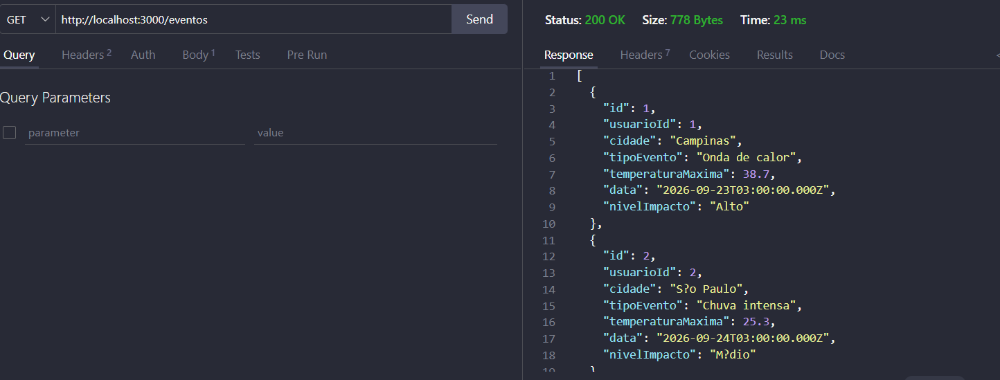
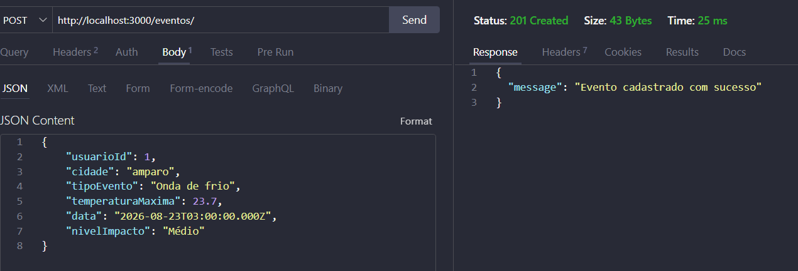
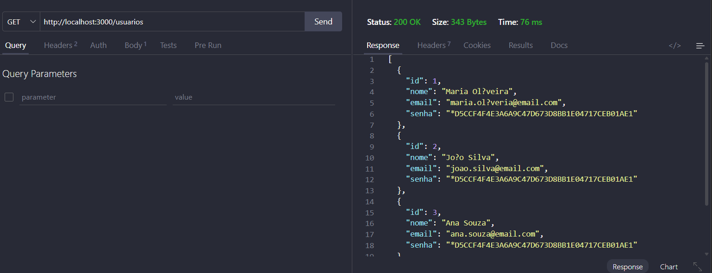
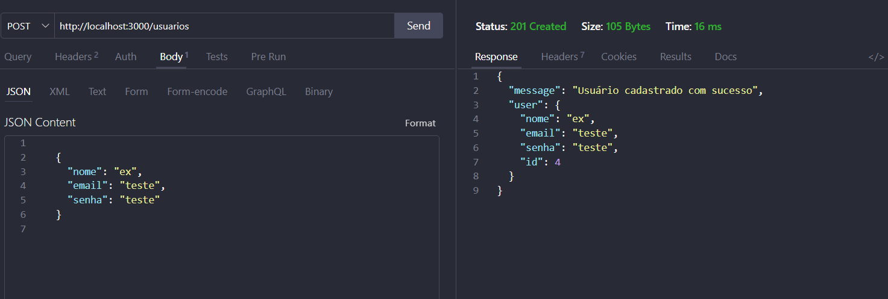

# Eventos climáticos
Projeto para aulas de back-end, com o objetivo de criar uma API RESTful para gerenciar eventos climáticos conectando Node.js com MariaDB. O projeto inclui funcionalidades para cadastrar, listar, atualizar e excluir eventos climáticos, bem como autenticação de usuários.

## MER e DER
<br>
<p align="left">
  
</p>
<p align="left">
  
</p>


<h2>Tecnologias utilizadas</h2>
<ul>
  <li>Node.js</li>
  <li>Express.js</li>
  <li>MariaDB (XAMPP)</li>
  <li>VsCode</li>
</ul>

# Instruções para testar
<ul>
<li>1 Clonar o repositório</li>
<li>2 Instalar as dependências com npm install</li>
<li>3 Configurar o banco de dados MariaDB com as tabelas necessárias</li>
  
* Abra o XAMPP de *start* no Mysql, abra o **Shell** acesse o MariaDB com o comando:
  
    ```bash
    mysql -u root
    ```
    
* Copie e cole o conteúdo do arquivo `db/script.sql` no shell do MariaDB para criar e popular o banco de dados.


Copie e cole o conteúdo do arquivo `db/script.sql` no shell do MariaDB para criar e popular o banco de dados.

<li>4 Iniciar o servidor com <code>npm run dev</code> </li>

<li>5 Testar as rotas da API utilizando o Thunder Client ou Insomnia ou Postman, conforme especificado no arquivo <code>src/rotes.js.</code></li>
</ul>

# Testes Thunder Client
<details>
  <summary>Listar Eventos</summary>
<p align="left">
  
</p>
</details>

   <details>
    <summary>Cadastrar Evento</summary>
<p align="left">
  
</p>
  </details>

  <details>
    <summary>Listar Usuários</summary>
<p align="left">
  
</p>
  </details>
    <details>
    <summary>Cadastrar Usuário</summary>
<p align="left">
  
</p>
  </details>

  
